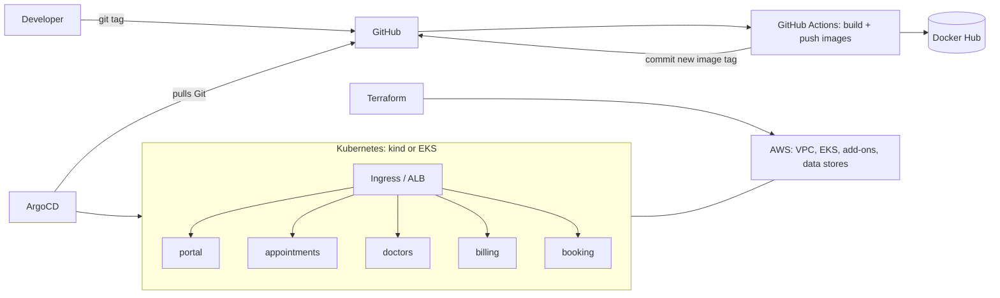

# Module-01: Project Overview

**Course section 1 · Status:** ☐ not started  ☐ done

## What this shows
CareConnect is a clinic appointment platform made of **5 microservices in 3 languages**, with the same production-style platform around it that the course builds for its retail store.

| CareConnect service | Language | Datastore | Retail-store equivalent |
|---|---|---|---|
| `portal` | Java (Spring Boot) | none | UI |
| `appointments` | Java (Spring Boot) | DynamoDB | Carts |
| `doctors` | Go | MySQL / MariaDB | Catalog |
| `billing` | Java (Spring Boot) | PostgreSQL + SQS | Orders |
| `booking` | Node.js | Redis + SQS | Checkout |

The services are deliberately minimal: each answers on `/` and `/health` and reports which container served the request. **The platform around them is the project.**

## Architecture

## Screenshot to take
`docs/screenshots/module-01-architecture.png`: the diagram above rendered on GitHub (open this README on GitHub and capture it).
