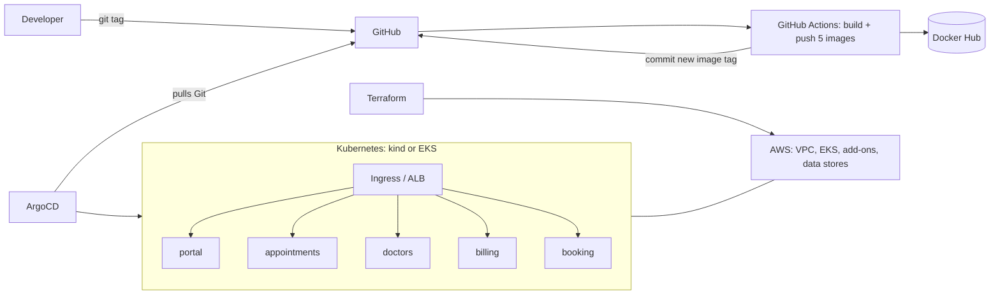

# CareConnect DevOps Portfolio

A DevOps project built module by module, following a hands-on course outline: **Docker, Docker Compose, BuildKit, Terraform, Kubernetes on EKS, Helm, Karpenter, autoscaling, OpenTelemetry, and a full CI/CD pipeline with GitOps**. The application is **CareConnect**, a clinic appointment platform made of five small microservices in Java, Go and Node.js.

> The services are intentionally minimal (each answers on `/` and `/health`). The platform around them is the project.

## The application

| Service | Language | Data store |
|---|---|---|
| `portal` | Java (Spring Boot) | none |
| `appointments` | Java (Spring Boot) | DynamoDB |
| `doctors` | Go | MySQL / MariaDB |
| `billing` | Java (Spring Boot) | PostgreSQL + SQS |
| `booking` | Node.js | Redis + SQS |

## How it fits together


## Modules

Each folder has its own README with what it shows, the commands, and the screenshot to take.

| Module | Topic | Runs on | Status |
|---|---|---|---|
| [01](Module-01-project-overview) | Project overview | n/a | ☐ |
| [02](Module-02-docker-commands) | Docker commands: install, run, build, push | Codespaces or EC2 | ☐ |
| [03](Module-03-dockerfile-mastery) | Dockerfile mastery: security, multi-stage, caching | Codespaces | ☐ |
| [04](Module-04-docker-compose) | Docker Compose: volumes, networks, health checks, scaling, profiles | Codespaces | ☐ |
| [05](Module-05-docker-buildkit) | BuildKit and multi-platform images | Codespaces | ☐ |
| [06](Module-06-terraform-basics) | Terraform basics: VPC, tfvars, remote backend, module | Emulator or AWS | ☐ |
| [07](Module-07-terraform-eks-cluster) | EKS cluster with Terraform | AWS (costs money) | ☐ |
| [08](Module-08-kubernetes-foundation) | Kubernetes: pods, deployments, services, ConfigMaps, StatefulSets | kind | ☐ |
| [09](Module-09-kubernetes-secrets) | Kubernetes secrets, Pod Identity, Secrets Manager | kind + EKS | ☐ |
| [10](Module-10-kubernetes-storage) | Persistent storage | kind | ☐ |
| [11](Module-11-kubernetes-ingress) | Ingress (nginx locally, ALB on AWS) | kind + EKS | ☐ |
| [12](Module-12-helm) | Helm | kind | ☐ |
| [13](Module-13-terraform-eks-addons) | EKS add-ons with Terraform | AWS | ☐ |
| [14](Module-14-aws-data-plane) | AWS data plane: DynamoDB, SQS, RDS, ElastiCache | Emulator or AWS | ☐ |
| [15](Module-15-external-dns-OPTIONAL) | ExternalDNS (optional, needs a domain) | AWS | ☐ |
| [16](Module-16-custom-domain-https-OPTIONAL) | Custom domain and HTTPS (optional, needs a domain) | AWS | ☐ |
| [17](Module-17-karpenter) | Karpenter and Spot | AWS | ☐ |
| [18](Module-18-hpa) | Horizontal Pod Autoscaler | kind | ☐ |
| [19](Module-19-helm-careconnect-on-eks) | Whole platform with Helm on EKS | AWS | ☐ |
| [20](Module-20-observability-opentelemetry) | OpenTelemetry: traces, logs, metrics | Local lab + AWS | ☐ |
| [21](Module-21-cicd-argocd) | CI/CD with GitHub Actions and ArgoCD | kind | ☐ |

Shared pieces used by several modules: `apps/` (the five services), `charts/careconnect-service/` (one Helm chart), `gitops/` (ArgoCD and per-service values), `k8s/` (kind config and local datastores), `.github/workflows/` (CI/CD).

## Suggested build order
1. **Free, on your machine:** Modules 01 to 05 (Docker), then 08 to 12 and 18 (Kubernetes and Helm on kind).
2. **The pipeline:** Module 21 (GitHub Actions and ArgoCD on kind). This is the best module for the portfolio.
3. **Terraform on the free emulator:** Modules 06 and 14.
4. **Real AWS (costs money, optional, do it in one sitting):** Modules 07, 13, 19, then 17 and 20. Destroy everything the same day.
5. **Skip unless you have a domain:** Modules 15 and 16.

## Before you start
Replace the placeholders `<your-user>` (your GitHub name) and `<dockerhub-user>` (your Docker Hub name) across the repo. The exact command is in [Module-21](Module-21-cicd-argocd).

## Quick start (5 minutes, Docker only)
```
cd Module-04-docker-compose
cp .env.example .env
docker compose up -d --build
curl localhost:8080/portal/health
curl localhost:8080/doctors/health
```

## Screenshots
Add yours in `docs/screenshots/` (names are listed in [that folder's README](docs/screenshots/README.md)) and show the best 4 to 6 here:

<!--  -->
<!--  -->
<!--  -->

## What I learned and problems I hit
_Write 3 to 5 real points here after you finish: something that broke, how you found the cause, and what you changed. These are the most valuable lines in the whole repository._

## Honest notes
- Modules marked "AWS" cost money while running; destroy the same day.
- Modules 15 and 16 need a domain name and are optional. Mark them "documented only" if you skip them.
- Anything you only validated (and did not deploy) should say so in its module README.
