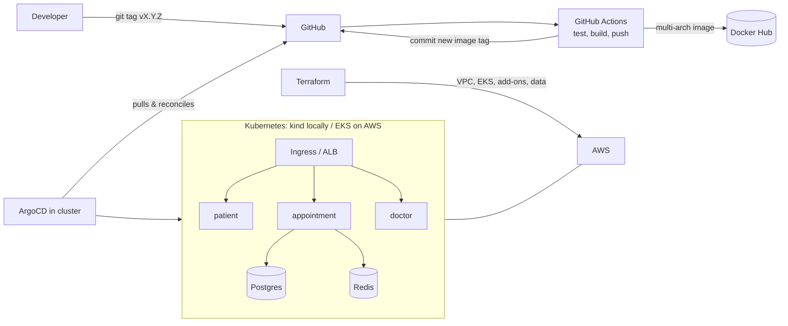

# CareConnect Platform

A clinic appointment booking platform, used as a hands-on **DevOps / platform engineering** project:
containerised microservices, Infrastructure as Code on AWS, Kubernetes on EKS, GitOps delivery with ArgoCD, and a full CI/CD pipeline.

> The application is intentionally tiny (three stand-in microservices that report their health and their dependencies).
> **The platform around it is the point.**

## What this demonstrates

| Area | What's in the repo |
|---|---|
| Containers | Hardened Dockerfile (pinned base, non-root, healthcheck), multi-arch images (amd64 + arm64) |
| Local dev | Docker Compose stack: gateway, 3 services, Postgres, MariaDB, Redis, health checks, startup ordering, profiles |
| IaC | Terraform: reusable VPC module, EKS cluster + node group + IAM, add-ons (Pod Identity, EBS CSI, LB Controller, Metrics Server), data plane (DynamoDB, SQS, optional RDS/ElastiCache) |
| Kubernetes | One Helm chart for every service: probes, resources, PDB, HPA, zone spreading, Ingress (ALB), per-service ServiceAccount |
| GitOps | ArgoCD app-of-apps + ApplicationSet, auto-sync, self-heal, prune, per-environment values |
| CI/CD | GitHub Actions: PR checks (tests, hadolint, Helm lint, Terraform validate), tagged releases, promotion by pull request |
| Operations | A full **runbook**: bootstrap, release, rollback, scaling, incident playbooks, cost control, teardown |

## Architecture


More detail and the reasoning behind each choice: [`docs/ARCHITECTURE.md`](docs/ARCHITECTURE.md).

## Repository layout

```
careconnect-platform/
├── apps/careconnect-service/   app.py, unit tests, Dockerfile
├── compose.yaml                local stack (Docker Compose)
├── docker/gateway/             nginx gateway config
├── charts/careconnect-service/ the one Helm chart
├── gitops/
│   ├── bootstrap/              root-local.yaml, root-eks.yaml (the only things applied by hand)
│   ├── apps/{local,eks}/       ApplicationSets (+ local datastores)
│   └── envs/{local,eks}/       values per service per environment. CI edits these.
├── k8s/                        kind config + local Postgres/Redis manifests
├── infra/
│   ├── modules/vpc/            reusable VPC module
│   └── stacks/                 00-local-floci, 10-eks, 20-addons (incl. ArgoCD), 30-data
├── .github/workflows/          pr.yml, release.yml, promote.yml
└── docs/                       ARCHITECTURE, RUNBOOK, DEMO, PROGRESS
```

## Quick start (pick one)

### 1. Docker Compose (5 minutes, no cluster)
```bash
cp .env.example .env
docker compose up -d --build
curl http://localhost:8080/patients/health
curl http://localhost:8080/appointments/health
docker compose down -v
```

### 2. kind + ArgoCD + GitOps (free, about 1 hour, the best demo)
Needs this repo pushed to **your** GitHub account (public). Full steps in [`docs/RUNBOOK.md`](docs/RUNBOOK.md) section 2A.

### 3. AWS EKS (real cloud, about $0.25/hr, destroy after)
Full steps in [`docs/RUNBOOK.md`](docs/RUNBOOK.md) section 2B.

## Before you push to GitHub
1. Search the repo for `<your-user>`, `<dockerhub-user>` and replace with your names.
2. Add repo secrets `DOCKERHUB_USERNAME` and `DOCKERHUB_TOKEN` (Settings > Secrets and variables > Actions).
3. Never commit `.env`, `*.tfstate` or `*.tfvars` (the `.gitignore` already blocks them).
4. Replace this README's screenshots section with your own (see [`docs/DEMO.md`](docs/DEMO.md)).

## Documentation
- [`docs/RUNBOOK.md`](docs/RUNBOOK.md): how to run, release, roll back, debug and shut it down
- [`docs/ARCHITECTURE.md`](docs/ARCHITECTURE.md): design and trade-offs
- [`docs/DEMO.md`](docs/DEMO.md): 5-minute demo script, screenshots checklist, interview talking points
- [`docs/PROGRESS.md`](docs/PROGRESS.md): milestone checklist to track your own build-out

## Honest status
This repo was assembled from tested building blocks, but each environment (kind, EKS) needs a first-run pass by you.
Version pins (Kubernetes, Helm charts, GitHub Actions) move: bump them if a pull fails.
